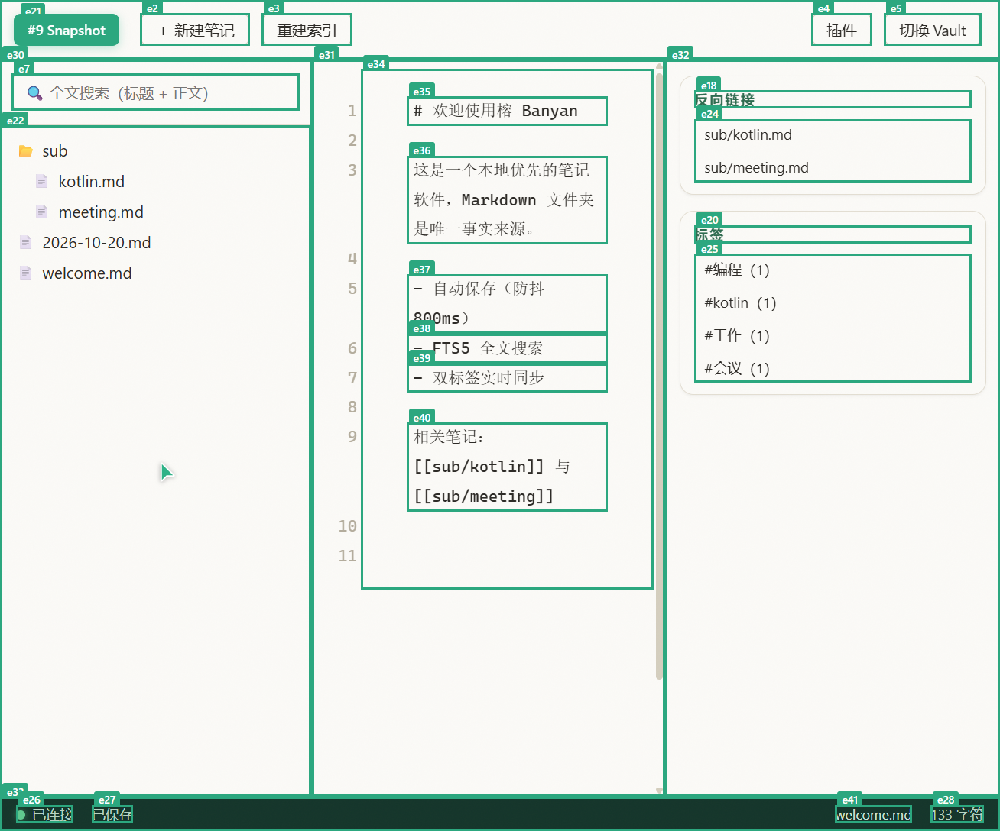

# 榕 Banyan

<p align="center">
  <a href="https://www.npmjs.com/package/banyan-notes"></a>
  <a href="https://www.npmjs.com/package/banyan-notes"></a>
  <a href="https://github.com/redjoker2025/Banyan/blob/main/LICENSE"></a>
</p>

<p align="center">
  
</p>

**榕**是一款本地优先、插件化的笔记软件（Web 版）。一个 Markdown 文件夹就是你的全部数据——
索引与日志都是可随时重建的派生物。插件内核内嵌 [Cordis](https://github.com/cordiverse/cordis)，
围绕三条立身之本构建：**权限声明与运行时拦截、启用时冲突检测、卸载无残留**。

## 快速开始

**方式一 · 免安装直接跑**（需要 Node.js ≥ 22）：

```powershell
npx banyan-notes web --vault D:\my-notes
```

**方式二 · 全局安装**：

```powershell
npm i -g banyan-notes
banyan web --vault D:\my-notes
```

启动后浏览器自动打开 `http://127.0.0.1:3210`（token 自动携带）。

常用参数：

| 参数 | 说明 |
|---|---|
| `--vault <文件夹>` | 笔记库位置（纯 Markdown 文件夹，不存在会自动创建） |
| `--port 4000` | 换端口（默认 3210，仅监听 127.0.0.1） |
| `--no-open` | 不自动打开浏览器 |

**方式三 · 从源码运行**（面向开发者）：

```powershell
git clone git@github.com:redjoker2025/Banyan.git
cd Banyan
pnpm install
pnpm test          # 72 个测试（内核冒烟 / 服务端 / 插件管理器）
pnpm --filter @banyan/web build
pnpm web -- --vault D:\my-notes
# 前端开发模式：pnpm dev（服务端）+ pnpm dev:web（Vite 热更）
```

## 功能

- **本地优先** — 纯 Markdown 文件夹是唯一事实来源；`FTS5` 全文索引、事件日志皆可重建
- **书写体验** — CodeMirror 6 编辑器、800ms 防抖自动保存（经插件可扩展的 `pipeline/save` 瀑布链）、居中限宽版式
- **实时同步** — 多浏览器标签页经 WebSocket 即时同步（含插件数据快照重放）
- **全文搜索** — trigram 分词，中文子串检索，带高亮片段
- **插件系统** — 双面插件（Node 服务端 + 浏览器客户端）、四个扩展点、能力级权限代理、审计日志

## 插件

启动后点击顶栏「插件」管理（启用/禁用即时生效）：

| 插件 | 说明 |
|---|---|
| 字数统计 | 保存时经 `pipeline/save` 瀑布链统计，状态栏实时显示 |
| 反向链接 | 右侧面板展示 `[[wiki]]` 与 Markdown 链接图 |
| 标签聚合 | 聚合 frontmatter `tags`，点击标签过滤笔记 |
| 今日笔记 | 命令「打开/创建今日笔记」→ `YYYY-MM-DD.md` |
| 冲突演示 A/B | 演示 `provides` 冲突：同 key 同时启用 → 409 指名双方 |
| 越权演示 | 演示 `net.domains` 越权 → 拦截并写入 `audit.jsonl` |

插件如何编写？见 [docs/dev/plugin-spec.md](docs/dev/plugin-spec.md)。

<p align="center">
  
</p>

## 架构

```
vendor/cordis（内核，只读内嵌）
  └─ @banyan/core        ctx key 契约 · 类型化事件 · waterfall/LIFO 内核扩展
      └─ @banyan/plugin-manager   manifest 严格校验 · 权限代理 · 冲突检测 · 审计
          └─ @banyan/server   Hono REST + WS（仅绑定 127.0.0.1，token 鉴权）
              └─ @banyan/web  Vue 3 + Pinia + CodeMirror 6 + 客户端插件宿主
```

数据目录 `<vault>/.banyan/`：`config.json`（token、启用列表）· `index.db`（FTS5，可删可重建）·
`journal.jsonl`（append-only 事件日志）· `audit.jsonl`（安全审计）· `installed/`（用户插件）。

## 开发

```powershell
pnpm test        # vitest，全部工作区
pnpm typecheck   # tsc 严格模式
pnpm build       # 全量构建
node scripts/api-smoke.mjs <baseUrl> <token>   # API 冒烟矩阵（34 项）
node scripts/build-npm.mjs   # 组装 npm 发布包
```

里程碑决策与取舍记录在 [docs/dev/decisions.md](docs/dev/decisions.md)，
内核 vendor 来源与升级流程在 [docs/dev/vendor.md](docs/dev/vendor.md)，
M1 图文测试报告见 [docs/dev/test-report-m1.md](docs/dev/test-report-m1.md)。

## Roadmap

- [x] M0 内核冒烟（Cordis 内嵌 + waterfall/LIFO 语义）
- [x] M1 Web 骨架（编辑器 / 搜索 / 同步 / 索引重建）
- [x] M2 插件系统 v0（权限 / 冲突 / 审计 / 双面插件）
- [ ] M3（规划中）：应用内对话框替代原生 prompt、暗色主题、更多扩展点、worker 级插件沙箱

## License

[MIT](LICENSE)

---

## About (English)

**Banyan** is a local-first, plugin-based note-taking app for the web. A plain
folder of Markdown files is the single source of truth — the full-text index
and journals are derivable at any time. It is built on an embedded
[Cordis](https://github.com/cordiverse/cordis) kernel with a capability-based
plugin system: plugins declare permissions (`fs.globs`, `net.domains`, `exec`),
which are enforced by a runtime proxy with a security audit log; `provides`
conflicts are detected at enable time; and unloading a plugin reverses every
registration it made.

```powershell
npx banyan-notes web --vault D:\my-notes
```
