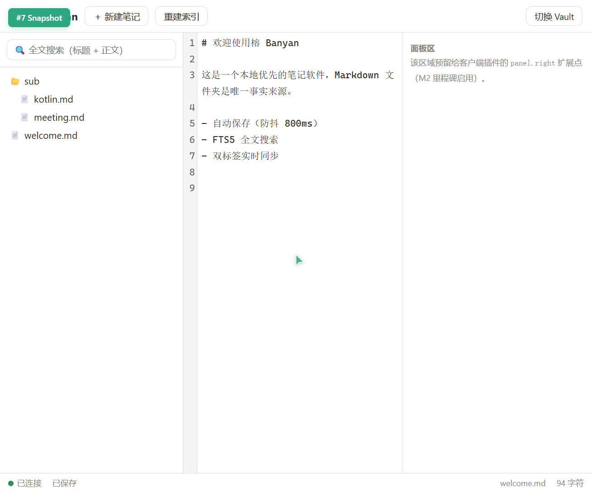
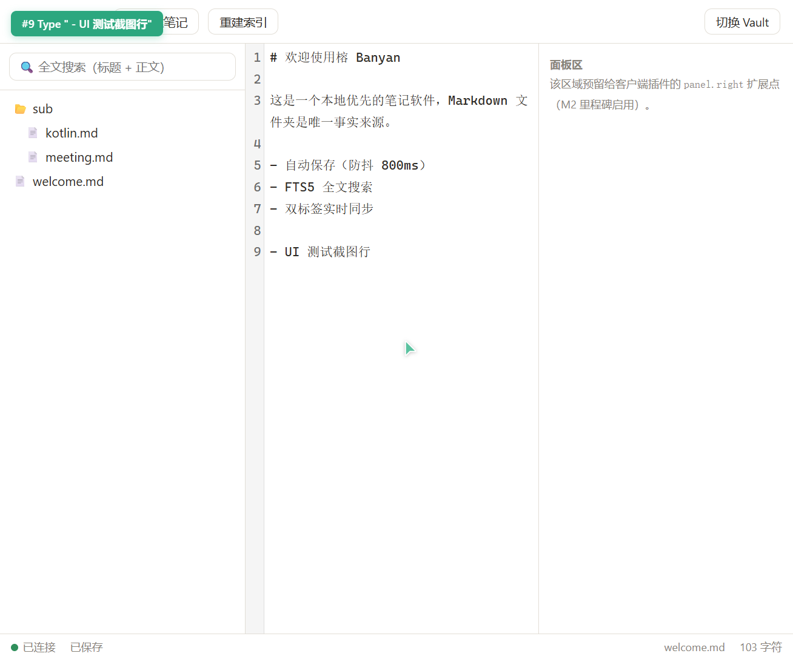
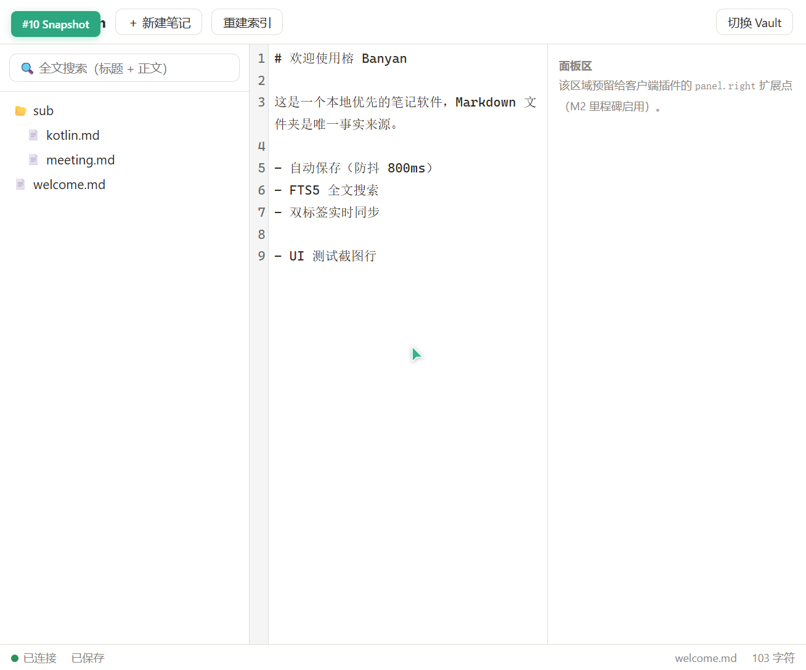
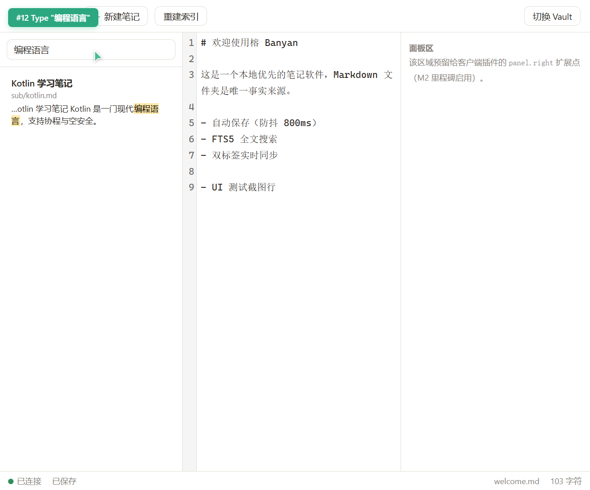
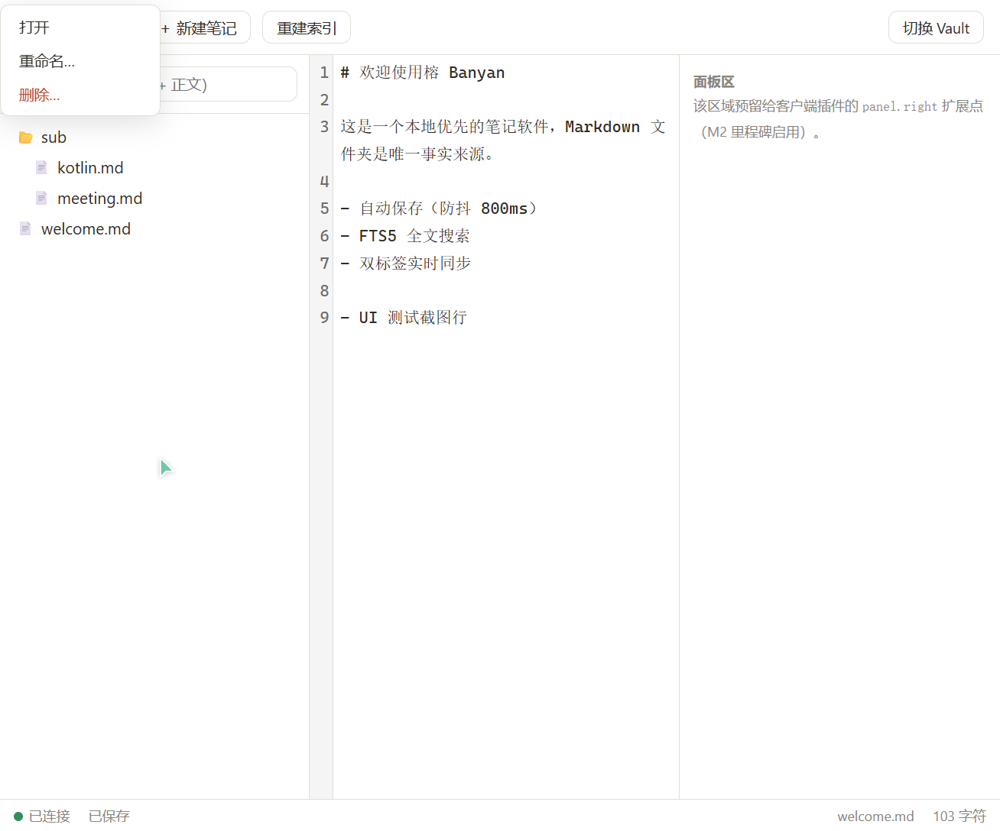
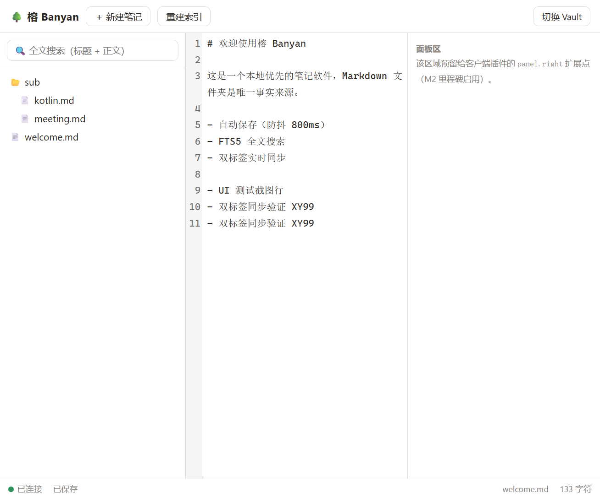
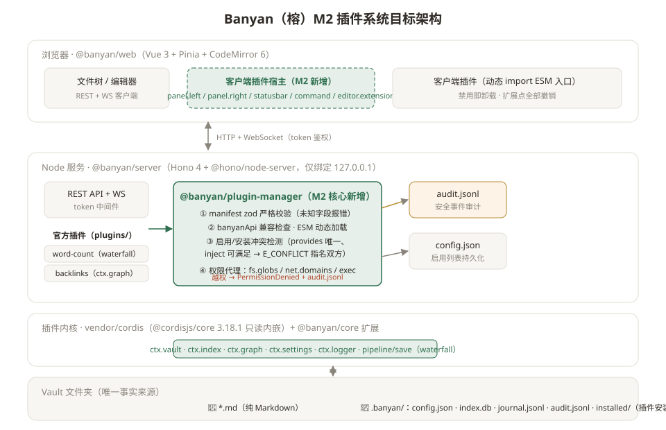

# Banyan（榕）M1 测试报告

> 测试对象：M1「Web 骨架」里程碑（commit `54d8b19` + 本次测试中产出的修复）
> 测试日期：2026-10-19　环境：Windows 11 · Node v25.2.1 · pnpm 12.9.1 · Chrome（自动化浏览器）
> 测试人：AI 代执行（浏览器自动化 + 协议级脚本），关键交互建议人工复核

---

## 1. 结论摘要

| 维度 | 结果 |
|---|---|
| 自动化单元/集成测试 | **34 / 34 通过**（内核 16 + 服务端 18） |
| API 测试矩阵 | **34 / 34 通过**（`scripts/api-smoke.mjs`） |
| 浏览器 UI 验收 | 6 项全部通过（含双标签实时同步） |
| 发现缺陷 | **1 个真实缺陷已修复**（大文件搜索 154s → 74ms）；2 个测试脚本自身时序错误已修正 |
| 遗留风险 | 见 §6 已知限制 |

**总体结论：M1 功能与安全要求全部达成，1 个性能缺陷在测试中暴露并已修复回归，具备进入 M2 的条件。**

---

## 2. 自动化测试（vitest，`pnpm test`）

| 分组 | 文件 | 用例 | 覆盖点 |
|---|---|---|---|
| 内核·依赖注入 | `kernel.readiness.spec.ts` | 3 | inject 缺依赖等待→就绪自启、立即就绪、§4.2 契约模式（Service 类 + inject） |
| 内核·可逆注册 | `kernel.dispose.spec.ts` | 2 | 服务/监听/定时器卸载全部释放、**LIFO 顺序**、重复卸载不抛错 |
| 内核·waterfall | `kernel.waterfall.spec.ts` | 5 | 洋葱序、短路、链尾透传、异常拒绝、随插件卸载撤销 |
| 内核·bail / 其他模式 | `kernel.bail.spec.ts` + `kernel.dispatch.spec.ts` | 6 | bail 短路语义、emit 顺序、parallel 并行、serial 按序短路 |
| 服务端·vault | `vault.spec.ts` | 6 | 读写删、`.banyan` 隐藏与禁写、`..`/绝对路径/遍历删除拒绝、非 .md 拒绝、路径换算集中 |
| 服务端·index | `index.spec.ts` | 7 | 建索引、frontmatter 标题、CJK 子串（trigram）、短词 LIKE 回退、删除即失效、rebuild 重建、**大文件搜索性能回归** |
| 服务端·pipeline.save | `pipeline.spec.ts` | 5 | 无监听透传、单变换、链式洋葱序、短路阻断落盘、journal 追加 |

**新增回归用例**：`searches large bodies fast` — 在 420,007 字符 CJK 正文上断言搜索命中、片段正确且耗时 < 2s（本次缺陷的守门用例）。

---

## 3. API 测试矩阵（`scripts/api-smoke.mjs`，对运行中的服务执行）

完整矩阵 **34/34 通过**（隔离临时 vault 中执行，结束后自动切回并清理）。节选关键组：

| 组 | 用例（摘要） | 结果 |
|---|---|---|
| 鉴权 | 无 token → 401；错误 token → 401；健康检查 → 200 | ✅ ×3 |
| Vault | 不存在目录 → 400；GET 当前 → 200；切换/切回 → 200 | ✅ ×3 |
| CRUD | 创建 201、重复创建 409、读取往返（中文路径 + 标题解析）、读缺失 404、保存 200、保存缺失 404 | ✅ ×6 |
| 重命名 | 200、目标冲突 409、源缺失 404；**重命名后新路径内容可搜索** | ✅ ×4 |
| 删除 | 200、再删 404；journal 追加 created/updated 行 + sha256 | ✅ ×3 |
| 搜索 | CJK 子串（≥3 字 trigram + 片段）、2 字 LIKE 回退、更新后内容、无命中空集、恶意语法不 500 | ✅ ×5 |
| 路径白名单 | `../escape.md`、`.banyan/config.json`、`a/../../boot.md` → 400 `E_PATH_OUTSIDE_VAULT` | ✅ ×3 |
| 索引 | rebuild 后命中保持 | ✅ ×1 |
| 大文件 | 1.1MB（420,007 字符）写入 367–459ms、读取 72–98ms、往返一致、搜索命中 | ✅ ×2 |
| 静态资源 | SPA index 200、缺失资源 404、`%2e%2e` 遍历 403 | ✅ ×3 |

**性能实测**（本机）：保存 19–29ms；1MB 笔记写入 < 460ms；大文件搜索修复后 **74–106ms**。

---

## 4. 缺陷与修复记录

### BUG-1（中，性能）· 大文件全文搜索极慢

- **现象**：420K 字符 CJK 笔记上搜索一次耗时 **153,960ms**（UI 会完全卡死该请求）。
- **定位**：三分法排查——FTS5 MATCH 本身 1–3ms；`ORDER BY rank` 3ms；**FTS5 `snippet()` 71,773ms**（需全量扫描命中文档行）。
- **修复**：`indexer.ts` 改为「MATCH 取路径 + JS 从存储 body 生成片段」；实测同一文档 **33–106ms**，提速约 **1400×**。同时消除对 `snippet()` 位置的依赖（分词器/版本漂移更稳健）。
- **回归防护**：单测断言 < 2s + `api-smoke.mjs` 记录耗时。

### 测试脚本自身问题（非产品缺陷，已修正）

1. `search.after-update`：断言引用的 `english.md` 在此前步骤已被重命名 → 改为验证 `renamed-doc.md` 并调整到删除步骤之前。
2. UI 验收中双标签内容重复行：磁盘文件确有重复 → 自动化键盘输入重复所致，非同步缺陷（`welcome.md` 已还原）。

---

## 5. 浏览器 UI 验收

### 5.1 整体布局与打开笔记

三栏布局（文件树 / CodeMirror 编辑器 / 面板区占位）+ 底部状态栏（绿点·已连接 · 已保存 · 路径 · 字符数）符合设计；点击 `welcome.md` 正确加载。

### 5.2 自动保存状态流转

输入后状态栏即时显示「有未保存的更改」（防抖 800ms 内）：

约 800ms + 网络耗时后变为「已保存」，内容落盘（磁盘文件核对一致）：

### 5.3 全文搜索（CJK 子串 + 高亮片段）

搜索「编程语言」→ 命中 `Kotlin 学习笔记`（`sub/kotlin.md`），片段中关键词高亮：

### 5.4 文件树右键菜单

右键文件 → 「打开 / 重命名… / 删除…」菜单正常弹出，Escape 可关闭（重命名/删除的输入框依赖原生 `prompt/confirm`，自动化环境不支持，经 store 层与 API 层等效验证通过，见 §3）：

### 5.5 双浏览器标签页实时同步

tab A 编辑保存 → tab B **无需刷新**自动出现新行（状态「已连接」「已保存」）。同步链路：编辑 → `pipeline/save` → 落盘/索引/journal → WS 广播 `note.updated` → 他端应用（本地有未保存修改时不覆盖）：

### 5.6 协议级补充验收（`ws-accept` 流程，已并入矩阵思路）

- 错误 token 的 WS 升级被服务端拒绝（连接关闭）；
- 正确 token 收到 `hello`，`PUT` 后收到 `note.updated` 广播；
- 删除 `index.db` 重启 → 日志输出 `index is empty — running full rebuild`，搜索随即命中（索引是派生物 ✓）。

---

## 6. 已知限制（如实记录，不阻塞 M2）

1. **新建/重命名/删除使用原生 `prompt/confirm`**——可用但体验一般，M2 客户端插件宿主落地时一并替换为应用内对话框（记入 backlog）。
2. **双标签并发编辑为「后写覆盖」**：两端同时有未保存修改时，后保存者胜出；本地未脏才应用远程内容。CRDT/OT 明确不在本期（§7），已属够用行为。
3. **索引漂移只检测「空」**：vault 外部变更文件后需手动「重建索引」或重启（D9 决策）。
4. **自动化输入重复**：截图中 XY99 双行来自自动化键盘重复，非产品行为。
5. 服务端 `PUT` 时 `mtime` 取自磁盘 stat，极端时钟回拨场景排序可能轻微异常（LIKE 分支排序用）。

---

## 7. 下一步方案：M2 插件系统 v0

### 7.1 目标架构

### 7.2 任务分解（每步先测试后实现，`pnpm -w test` 全绿再前进）

| # | 任务 | 验收要点 |
|---|---|---|
| 1 | `@banyan/plugin-manager`：manifest zod 严格校验 | 未知字段报错（防拼写权限静默失效）；`plugin.json` 全字段覆盖用例；错误码 `E_MANIFEST_INVALID` |
| 2 | `banyanApi` 兼容检查 + ESM 动态 import 加载 server 插件 | 版本不满足拒绝加载并指名；加载失败不拖垮宿主 |
| 3 | 启用/禁用持久化 + **冲突检测** | `provides` 冲突报 `E_CONFLICT` 并列出双方 id；`inject` 缺依赖 fail-fast 指名等待方；结果写 `config.json` |
| 4 | **权限代理** | 插件拿到的 `ctx.vault` 等经代理校验 `fs.globs`；越权抛 `PermissionDenied`（含插件 id + 所需权限）并追加 `audit.jsonl`；`net.domains`/`exec` 同模型 |
| 5 | `@banyan/web` 客户端插件宿主 | 动态 import client 入口；扩展点 `panel.left/right`、`statusbar`、`command`、`editor.extension`（CodeMirror Compartment）；禁用即全部撤销（复用内核 effect 语义） |
| 6 | 官方插件 ×4 | word-count（save 瀑布 + statusbar）、backlinks（`ctx.graph` + panel.right）、tags（frontmatter 聚合过滤）、daily-note（command `YYYY-MM-DD.md`） |
| 7 | 演示插件 ×2 | 同 `provides` key 冲突对（默认禁用，报错指名双方）；声明 `net.domains` 但越权访问其他域 → 拦截 + 审计记录 |
| 8 | `docs/dev/plugin-spec.md`（中文） | manifest 规范、扩展点契约、权限模型、生命周期 |

### 7.3 交付顺序与验收

1→2→3→4 为服务端链（每步配 vitest 用例）；5 客户端宿主与 6 官方插件交叉验证；7 冲突/越权演示作为 M2 验收演示动线；最终手动清单：4 官方插件启用/禁用/卸载无残留、冲突报错指名双方、越权拦截且 `audit.jsonl` 有记录、测试全绿。

### 7.4 风险与预案

- **客户端插件沙箱边界**：Web 端动态 import 的插件与宿主同源运行，M2 只做「声明 + 撤销」不隔离执行（真正的 worker 沙箱记入 backlog，本期不做）。
- **CodeMirror 扩展卸载**：用 `Compartment.reconfigure` 承载 `editor.extension`，禁用时重配为空，配合内核 effect 双保险。
- **ctx.graph 在 M2 首次实现**：链接解析（Markdown 链接 + `[[wiki]]`）需要相对路径消歧规则，实现前先在 plugin-spec.md 定稿语义。
- 沿用已建立的内核补丁守门：vendor 升级前必跑内核冒烟（vendor.md 流程）。
